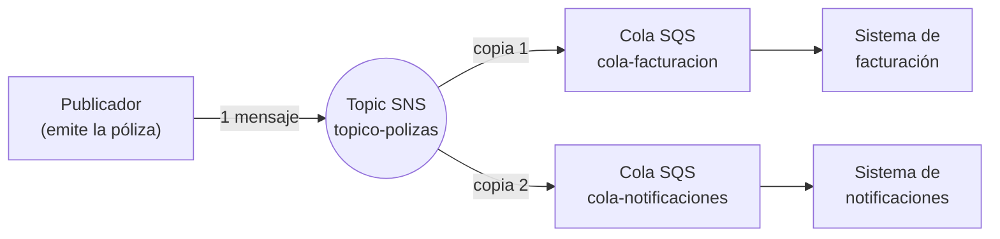
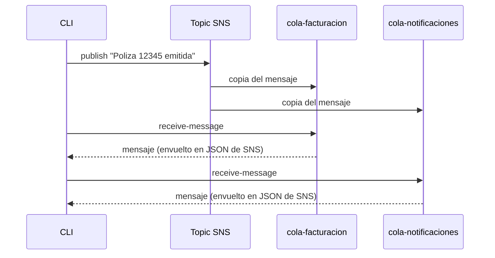
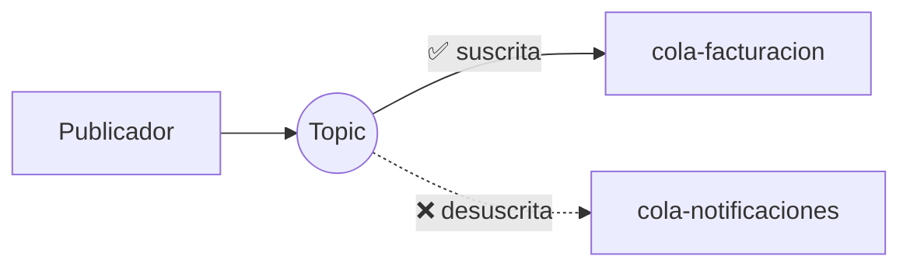

# SNS + SQS: patrón Fan-out con floci

Publicar **un solo mensaje** en un topic de Amazon SNS y entregarlo automáticamente a **varias colas SQS**, todo en local con [floci](https://github.com/) (emulador de AWS), PowerShell y la AWS CLI.

| | |
|---|---|
| **Servicios** | SNS, SQS |
| **Nivel** | Básico |
| **Región** | `us-east-1` |
| **Herramientas** | floci, AWS CLI, PowerShell |

---

## Índice

1. [Objetivo](#1-objetivo)
2. [Conceptos clave](#2-conceptos-clave)
3. [Escenario](#3-escenario)
4. [Requisitos](#4-requisitos)
5. [Despliegue](#5-despliegue)
6. [Qué hace cada parte del script](#6-qué-hace-cada-parte-del-script)
7. [Verificación](#7-verificación)
8. [Pruebas de comportamiento](#8-pruebas-de-comportamiento)
9. [Visualización en Floci UI](#9-visualización-en-floci-ui)
10. [Problemas comunes](#10-problemas-comunes)
11. [Limpieza](#11-limpieza)
12. [Resumen](#12-resumen)
13. [Seguridad](#13-seguridad)

---

## 1. Objetivo

- Entender qué es un **topic** de SNS y qué es una **suscripción**.
- Implementar el patrón **fan-out**: un evento, varios destinos.
- Verificar por CLI que cada destino recibe su propia copia.
- Comprender por qué el mensaje llega envuelto en un JSON de SNS.

---

## 2. Conceptos clave

### SNS como un grupo de mensajería

| En un grupo de mensajería | En AWS |
|---|---|
| El grupo | **Topic** de SNS |
| Quien escribe en el grupo | **Publicador** (*publisher*) |
| Cada miembro | **Suscriptor** (*subscriber*) |
| El mensaje | **Mensaje** |

Cuando alguien escribe **una vez** en el grupo, **todos** los miembros lo reciben.

### SQS como un buzón

SQS es una **cola**: los mensajes esperan almacenados hasta que un consumidor los lee y los procesa.

### SQS vs SNS

| | **SQS** (cola) | **SNS** (topic) |
|---|---|---|
| Función | Almacenar mensajes hasta que se procesen | Repartir copias a varios destinos |
| Receptores | **Un** consumidor por mensaje | **Todos** los suscriptores |
| Entrega | El consumidor consulta la cola (*pull*) | SNS envía el mensaje (*push*) |
| Persistencia | Sí, hasta que se lee o se borra | No, reparte y no guarda |

### Fan-out

**Fan-out** ("abanico") es el patrón en el que un mensaje se abre en varias copias, una por destino. Se usa cuando **varios sistemas** deben reaccionar al **mismo evento**, sin que el publicador conozca a cada uno.

---

## 3. Escenario

Al emitirse una póliza, dos sistemas necesitan enterarse:

- **Facturación:** genera el cobro.
- **Notificaciones:** avisa al cliente.

Sin SNS, el emisor tendría que enviar el mensaje dos veces, una por sistema, y modificar su código cada vez que se añada otro. Con SNS, publica una vez y el topic reparte.

### Arquitectura



### Flujo en el tiempo



### Versión en texto

```
                         ┌──────────────────────┐
                    ┌───▶│  cola-facturacion    │
┌────────────┐      │    └──────────────────────┘
│ Publicador │─▶ [SNS]
└────────────┘  topico-polizas
                    │    ┌──────────────────────┐
                    └───▶│ cola-notificaciones  │
                         └──────────────────────┘
```

---

## 4. Requisitos

- floci en ejecución (endpoint `http://localhost:4566`).
- AWS CLI configurada con credenciales ficticias.
- PowerShell (la terminal integrada de VS Code es suficiente).
- Región para toda la práctica: **`us-east-1`**.

> La región debe ser la misma en el script, en los comandos de verificación y en Floci UI. Ver [Problemas comunes](#10-problemas-comunes).

---

## 5. Despliegue

Todo el despliegue está en `sns-fanout.ps1`.

```powershell
$endpoint = "http://localhost:4566"
$region   = "us-east-1"

# 1. Crear el topic
$topicArn = aws sns create-topic --name topico-polizas `
  --endpoint-url $endpoint --region $region `
  --query TopicArn --output text

# 2. Crear dos colas
foreach ($q in "cola-facturacion", "cola-notificaciones") {
    aws sqs create-queue --queue-name $q `
      --endpoint-url $endpoint --region $region | Out-Null
}

# 3. Suscribir cada cola al topic
foreach ($q in "cola-facturacion", "cola-notificaciones") {
    $url = aws sqs get-queue-url --queue-name $q `
      --endpoint-url $endpoint --region $region `
      --query QueueUrl --output text

    $qArn = aws sqs get-queue-attributes --queue-url $url `
      --attribute-names QueueArn `
      --endpoint-url $endpoint --region $region `
      --query Attributes.QueueArn --output text

    aws sns subscribe --topic-arn $topicArn `
      --protocol sqs --notification-endpoint $qArn `
      --endpoint-url $endpoint --region $region | Out-Null
}

# 4. Publicar UN mensaje
aws sns publish --topic-arn $topicArn `
  --message "Poliza 12345 emitida" `
  --endpoint-url $endpoint --region $region

# 5. Verificar que llegó a AMBAS colas
foreach ($q in "cola-facturacion", "cola-notificaciones") {
    Write-Host "--- $q ---"
    $url = aws sqs get-queue-url --queue-name $q `
      --endpoint-url $endpoint --region $region `
      --query QueueUrl --output text
    aws sqs receive-message --queue-url $url `
      --endpoint-url $endpoint --region $region
}
```

### Ejecución

```powershell
.\sns-fanout.ps1
```

Si PowerShell bloquea la ejecución de scripts, habilitarla solo para la sesión actual:

```powershell
Set-ExecutionPolicy -Scope Process -ExecutionPolicy Bypass
.\sns-fanout.ps1
```

### Salida esperada

```text
{
    "MessageId": "e5b1c5ff-bc55-4b27-84d0-714e7ea7fb4c"
}

--- cola-facturacion ---
{
    "Messages": [
        {
            "MessageId": "a4e028e3-112e-470d-be8c-3b28bca2fba0",
            "ReceiptHandle": "...",
            "MD5OfBody": "...",
            "Body": "{\"Type\":\"Notification\",\"MessageId\":\"e5b1c5ff-...\",\"TopicArn\":\"arn:aws:sns:us-east-1:000000000000:topico-polizas\",\"Message\":\"Poliza 12345 emitida\", ...}"
        }
    ]
}

--- cola-notificaciones ---
{
    "Messages": [ { ... mismo contenido, distinto MessageId de SQS ... } ]
}
```

Los identificadores serán distintos en cada ejecución. Lo relevante es que **ambas colas** devuelven el mensaje.

---

## 6. Qué hace cada parte del script

### Variables iniciales

| Línea | Función |
|---|---|
| `$endpoint = "http://localhost:4566"` | Dirección de floci. Sin ella, la CLI se conectaría al AWS real. |
| `$region = "us-east-1"` | Región donde se crean los recursos. |

### Paso 1: crear el topic

| Parte | Función |
|---|---|
| `aws sns create-topic --name topico-polizas` | Crea el topic. |
| `` ` `` (acento grave al final de línea) | En PowerShell indica que el comando continúa en la línea siguiente. |
| `--endpoint-url $endpoint --region $region` | Dirige el comando a floci y a la región elegida. |
| `--query TopicArn --output text` | Filtra la respuesta JSON para quedarse solo con el `TopicArn`, en texto plano. |
| `$topicArn = ...` | Guarda el valor en una variable para usarlo después. |

> **¿Qué es un ARN?** Es el identificador único de un recurso en AWS. Ejemplo: `arn:aws:sns:us-east-1:000000000000:topico-polizas`.

### Paso 2: crear las colas

| Parte | Función |
|---|---|
| `foreach ($q in "cola-facturacion", "cola-notificaciones") { ... }` | Repite el bloque una vez por cada nombre. |
| `aws sqs create-queue --queue-name $q` | Crea la cola. |
| `\| Out-Null` | Descarta la respuesta para no saturar la pantalla. |

### Paso 3: suscribir las colas al topic

| Parte | Función |
|---|---|
| `aws sqs get-queue-url ...` | Obtiene la **URL** de la cola, que se usa para operar sobre ella. |
| `aws sqs get-queue-attributes ... --attribute-names QueueArn` | Obtiene el **ARN** de la cola, que se usa para identificarla ante otros servicios. |
| `aws sns subscribe --topic-arn $topicArn` | Crea la suscripción. |
| `--protocol sqs` | El destino es una cola SQS (también existen `email`, `lambda`, `http`...). |
| `--notification-endpoint $qArn` | El destino concreto: el ARN de la cola. |

> **URL vs ARN:** la URL sirve para *trabajar* con la cola (enviar, leer). El ARN sirve para *identificarla* desde otros servicios, como SNS.

### Paso 4: publicar

| Parte | Función |
|---|---|
| `aws sns publish` | Publica un mensaje en el topic. |
| `--message "Poliza 12345 emitida"` | Contenido del mensaje. |

La respuesta incluye un `MessageId` que confirma la recepción por parte de SNS.

### Paso 5: verificar

| Parte | Función |
|---|---|
| `Write-Host "--- $q ---"` | Imprime un título para distinguir cada cola. |
| `aws sqs receive-message --queue-url $url` | Lee el mensaje de la cola. |

---

## 7. Verificación

### Preparación de la sesión

Variables y una función auxiliar para contar mensajes de una cola:

```powershell
$endpoint = "http://localhost:4566"
$region   = "us-east-1"
$topicArn = "arn:aws:sns:us-east-1:000000000000:topico-polizas"

function Contar($nombreCola) {
    $url = aws sqs get-queue-url --queue-name $nombreCola `
      --endpoint-url $endpoint --region $region `
      --query QueueUrl --output text
    $n = aws sqs get-queue-attributes --queue-url $url `
      --attribute-names ApproximateNumberOfMessages `
      --endpoint-url $endpoint --region $region `
      --query Attributes.ApproximateNumberOfMessages --output text
    Write-Host "$nombreCola -> $n mensaje(s)"
}
```

### 7.1 El topic existe

```powershell
aws sns list-topics --endpoint-url $endpoint --region $region
```

Debe aparecer un `TopicArn` terminado en `:topico-polizas`.

### 7.2 Las suscripciones existen

```powershell
aws sns list-subscriptions-by-topic --topic-arn $topicArn --endpoint-url $endpoint --region $region
```

Deben listarse **2 suscripciones**, con `Protocol: sqs` y un `Endpoint` distinto en cada una.

### 7.3 Conteo de mensajes

```powershell
Contar "cola-facturacion"
Contar "cola-notificaciones"
```

Salida esperada:

```text
cola-facturacion -> 1 mensaje(s)
cola-notificaciones -> 1 mensaje(s)
```

> Si el contador muestra `0`, esperar unos 30 segundos y repetir. Un mensaje leído con `receive-message` permanece **invisible** durante el *visibility timeout* (30 s por defecto) y no se contabiliza en ese lapso.

### 7.4 Lectura del contenido sin consumirlo

```powershell
$urlFact = aws sqs get-queue-url --queue-name cola-facturacion --endpoint-url $endpoint --region $region --query QueueUrl --output text
aws sqs receive-message --queue-url $urlFact --visibility-timeout 0 --endpoint-url $endpoint --region $region
```

`--visibility-timeout 0` mantiene el mensaje disponible tras leerlo.

### Estructura del mensaje

El `Body` no contiene solo el texto publicado, sino un JSON generado por SNS:

```json
{
  "Type": "Notification",
  "MessageId": "e5b1c5ff-bc55-4b27-84d0-714e7ea7fb4c",
  "TopicArn": "arn:aws:sns:us-east-1:000000000000:topico-polizas",
  "Timestamp": "2026-11-02T01:22:30.391746618Z",
  "Message": "Poliza 12345 emitida",
  "MessageAttributes": {}
}
```

Es como un **sobre con remitente y sello**: el texto original está en el campo `Message`, y SNS añade el origen, la hora y un identificador. La aplicación que consuma la cola debe leer `Message`.

### Cómo interpretar la salida

| Observación | Significado |
|---|---|
| Se publicó **una vez** y hay mensaje en **ambas colas** | Fan-out |
| El `MessageId` dentro del `Body` es **el mismo** en ambas colas | Las copias provienen del mismo mensaje original |
| El `MessageId` de SQS (fuera del `Body`) es **distinto** en cada cola | Cada cola asigna su propio ID a su copia |
| El `TopicArn` incluye `us-east-1` | Confirma la región de despliegue |

---

## 8. Pruebas de comportamiento

Tres pruebas cortas para confirmar cómo se comporta el patrón. Se ejecutan en orden, con la sesión preparada en la [sección 7](#7-verificación).

### Prueba 1: las colas son independientes

**Hipótesis:** borrar el mensaje de una cola no afecta a la otra.

**Paso 1.** Obtener el mensaje de `cola-facturacion` y su identificador de borrado (`ReceiptHandle`):

```powershell
$urlFact = aws sqs get-queue-url --queue-name cola-facturacion --endpoint-url $endpoint --region $region --query QueueUrl --output text

$handle = aws sqs receive-message --queue-url $urlFact --visibility-timeout 0 `
  --endpoint-url $endpoint --region $region `
  --query "Messages[0].ReceiptHandle" --output text
```

**Paso 2.** Borrarlo:

```powershell
aws sqs delete-message --queue-url $urlFact --receipt-handle $handle --endpoint-url $endpoint --region $region
```

**Paso 3.** Contar:

```powershell
Contar "cola-facturacion"
Contar "cola-notificaciones"
```

**Resultado esperado:**

```text
cola-facturacion -> 0 mensaje(s)
cola-notificaciones -> 1 mensaje(s)
```

**Conclusión:** cada suscriptor tiene su propia copia y la procesa a su ritmo.

---

### Prueba 2: cada publicación llega a todos los suscriptores

**Paso 1.** Publicar un mensaje nuevo:

```powershell
aws sns publish --topic-arn $topicArn --message "Poliza 67890 emitida" --endpoint-url $endpoint --region $region
```

**Paso 2.** Contar:

```powershell
Contar "cola-facturacion"
Contar "cola-notificaciones"
```

**Resultado esperado:** ambas colas aumentan en 1 mensaje respecto al conteo anterior.

---

### Prueba 3: quitar un suscriptor

**Hipótesis:** una cola que deja de estar suscrita deja de recibir mensajes.



**Paso 1.** Obtener el ARN de la suscripción de `cola-notificaciones`:

```powershell
$subArn = aws sns list-subscriptions-by-topic --topic-arn $topicArn `
  --endpoint-url $endpoint --region $region `
  --query "Subscriptions[?contains(Endpoint,'cola-notificaciones')].SubscriptionArn" --output text

$subArn
```

**Paso 2.** Eliminar la suscripción:

```powershell
aws sns unsubscribe --subscription-arn $subArn --endpoint-url $endpoint --region $region
```

**Paso 3.** Anotar el conteo **antes** de publicar:

```powershell
Contar "cola-facturacion"
Contar "cola-notificaciones"
```

**Paso 4.** Publicar un mensaje nuevo:

```powershell
aws sns publish --topic-arn $topicArn --message "Poliza 11111 emitida" --endpoint-url $endpoint --region $region
```

**Paso 5.** Contar **después**:

```powershell
Contar "cola-facturacion"
Contar "cola-notificaciones"
```

**Paso 6.** Confirmar el contenido de cada cola:

```powershell
$urlNotif = aws sqs get-queue-url --queue-name cola-notificaciones --endpoint-url $endpoint --region $region --query QueueUrl --output text

aws sqs receive-message --queue-url $urlFact --max-number-of-messages 10 --visibility-timeout 0 `
  --endpoint-url $endpoint --region $region --query "Messages[*].Body" --output text

aws sqs receive-message --queue-url $urlNotif --max-number-of-messages 10 --visibility-timeout 0 `
  --endpoint-url $endpoint --region $region --query "Messages[*].Body" --output text
```

**Resultado esperado:**

| Cola | ¿Contiene `Poliza 11111`? | Estado |
|---|---|---|
| `cola-facturacion` | Sí | Suscrita: recibe copias |
| `cola-notificaciones` | No | Desuscrita: no recibe |

**Conclusión:** el topic solo entrega mensajes a las suscripciones activas en el momento de la publicación.

> Lo relevante es comparar el conteo de cada cola **antes y después** de publicar, no el valor absoluto. Si una cola arrastra mensajes de pruebas anteriores, su contador parte de otro valor.

---

## 9. Visualización en Floci UI

1. Abrir Floci UI en el navegador.
2. Ir a **SQS** (sección *Integration* del menú lateral).
3. Pulsar **Refresh**.
4. Deben aparecer `cola-facturacion` y `cola-notificaciones` con su número de mensajes.

Floci UI muestra los recursos de **una única región**. Si no aparecen, revisar la [región](#10-problemas-comunes). En las versiones donde no hay una sección dedicada a SNS, el topic y sus suscripciones se verifican por CLI (apartados 7.1 y 7.2).

---

## 10. Problemas comunes

| Síntoma | Causa probable | Solución |
|---|---|---|
| Los recursos creados por CLI **no aparecen en Floci UI** | La CLI y la interfaz usan **regiones distintas** (p. ej. `us-east-2` vs `us-east-1`) | Alinear `$region` en el script con la región que muestra la interfaz y volver a ejecutarlo |
| Una cola existe pero parece "otra" | Dos colas en regiones distintas pueden tener **el mismo nombre** y ser recursos independientes | Comparar con `aws sqs list-queues --region <región>` en cada región |
| El contador de mensajes muestra `0` justo después de leer | El mensaje está **invisible** durante el *visibility timeout* | Esperar ~30 s, o leer con `--visibility-timeout 0` |
| `receive-message` no elimina el mensaje | Solo lo oculta temporalmente | Usar `delete-message` con el `ReceiptHandle` |
| `.\sns-fanout.ps1 cannot be loaded` | Política de ejecución de PowerShell | `Set-ExecutionPolicy -Scope Process -ExecutionPolicy Bypass` |
| Las variables (`$endpoint`, `Contar`...) dejan de existir | Se cerró la terminal; las variables viven solo en la sesión | Volver a pegar el bloque de preparación de la [sección 7](#7-verificación) |
| `$subArn` sale vacío en la prueba 3 | La cola ya estaba desuscrita o el nombre del filtro no coincide | Revisar con `list-subscriptions-by-topic` |
| Cambios en el script que "no se aplican" | El archivo no se guardó antes de ejecutarlo | Guardar (`Ctrl+S`) y volver a ejecutar |
| El mensaje llega con formato JSON extraño | Comportamiento normal: SNS envuelve el mensaje | Leer el campo `Message` del `Body` |

**Comprobación rápida de región:**

```powershell
aws sqs list-queues --endpoint-url $endpoint --region us-east-1
aws sqs list-queues --endpoint-url $endpoint --region us-east-2
```

---

## 11. Limpieza

Elimina únicamente los recursos de esta práctica. Guardar como `limpiar.ps1`:

```powershell
$endpoint = "http://localhost:4566"
$region   = "us-east-1"
$topicArn = "arn:aws:sns:us-east-1:000000000000:topico-polizas"

# Eliminar el topic (también elimina sus suscripciones)
aws sns delete-topic --topic-arn $topicArn --endpoint-url $endpoint --region $region

# Eliminar las dos colas
foreach ($q in "cola-facturacion", "cola-notificaciones") {
    $url = aws sqs get-queue-url --queue-name $q `
      --endpoint-url $endpoint --region $region `
      --query QueueUrl --output text
    aws sqs delete-queue --queue-url $url --endpoint-url $endpoint --region $region
}
```

Comprobar que ya no existen:

```powershell
aws sns list-topics --endpoint-url $endpoint --region $region
aws sqs list-queues --endpoint-url $endpoint --region $region
```

---

## 12. Resumen

**¿Qué diferencia hay entre SQS y SNS?**
SQS almacena mensajes para que **un** consumidor los lea. SNS reparte una copia del mensaje a **todos** sus suscriptores.

**¿Qué es el fan-out y para qué sirve?**
Es el patrón en el que un evento se replica a varios destinos. Permite que varios sistemas reaccionen al mismo evento sin que el publicador los conozca ni los llame uno por uno. Añadir un nuevo destino solo requiere crear una suscripción.

**¿Por qué el mensaje llega envuelto en un JSON?**
Porque SNS añade metadatos (topic de origen, identificador, hora) alrededor del texto publicado, que queda en el campo `Message`. Existe la opción *raw message delivery* para entregar el texto sin envoltorio.

**¿Qué cambia respecto a AWS real?**
Cada cola SQS necesita una **política de acceso** que permita a SNS escribir en ella (`sqs:SendMessage`, con el ARN del topic como condición). floci no la exige, pero en un entorno real, sin ella, los mensajes no llegarían.

| Concepto | Idea clave |
|---|---|
| Topic | Canal al que se publica; no guarda mensajes |
| Suscripción | Enlace entre un topic y un destino |
| Fan-out | Un mensaje, una copia por suscriptor |
| Independencia | Cada cola procesa y borra su copia sin afectar a las demás |
| Región | Los recursos viven en una región; deben coincidir CLI e interfaz |

---

## 13. Seguridad

- Esta práctica usa **credenciales ficticias** de floci.
- Nunca subir credenciales reales (access keys, archivos `.env`, `.pem`) al repositorio.
- El repositorio incluye un `.gitignore` en la raíz para evitarlo. Antes de cada commit, revisar con:

```powershell
git status
```
