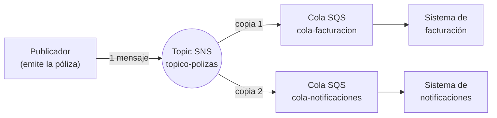
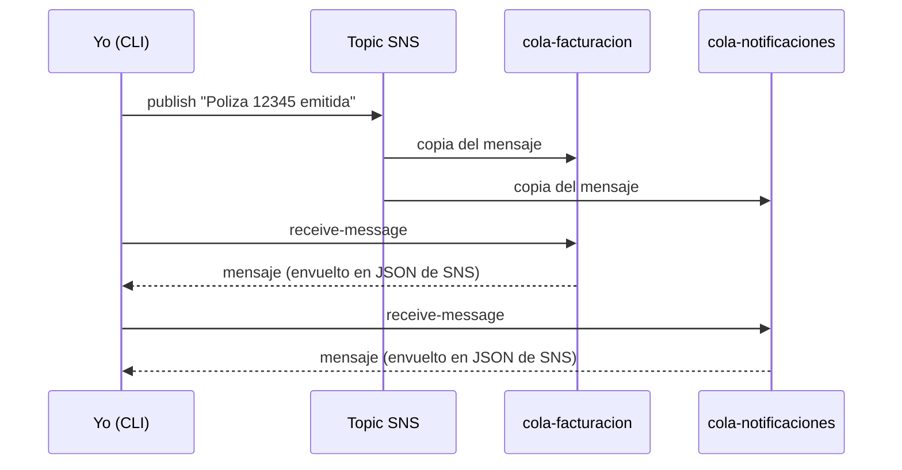
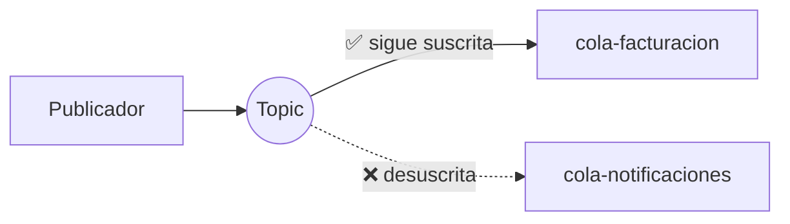

# Práctica SNS: enviar un mensaje a varios destinos a la vez (Fan-out)

> **Resumen en una frase:** publico **un solo mensaje** en un "tema" (topic) de SNS y ese mensaje llega **automáticamente a varias colas SQS**.

Práctica hecha en local con **floci** (emulador de AWS), usando **PowerShell** y la **AWS CLI**.

---

## Índice

1. [¿Qué voy a aprender?](#1-qué-voy-a-aprender)
2. [Conceptos explicados fácil](#2-conceptos-explicados-fácil)
3. [El escenario de la práctica](#3-el-escenario-de-la-práctica)
4. [Requisitos](#4-requisitos)
5. [Paso a paso: crear todo](#5-paso-a-paso-crear-todo)
6. [Explicación del script línea por línea](#6-explicación-del-script-línea-por-línea)
7. [Cómo comprobar que funcionó](#7-cómo-comprobar-que-funcionó)
8. [Experimentos para entender mejor SNS](#8-experimentos-para-entender-mejor-sns)
9. [Ver los recursos en la interfaz de floci](#9-ver-los-recursos-en-la-interfaz-de-floci)
10. [Problemas que tuve y cómo los resolví](#10-problemas-que-tuve-y-cómo-los-resolví)
11. [Limpieza](#11-limpieza)
12. [Conclusiones](#12-conclusiones)
13. [Nota de seguridad](#13-nota-de-seguridad)

---

## 1. ¿Qué voy a aprender?

- Qué es **SNS** y en qué se diferencia de **SQS**.
- Qué es un **topic** y qué es una **suscripción**.
- Qué es el patrón **fan-out** (un mensaje, muchos destinos).
- Cómo comprobar con la CLI que cada destino recibió su copia.
- Por qué el mensaje llega "envuelto" en un JSON de SNS.

---

## 2. Conceptos explicados fácil

### Analogía: el grupo de WhatsApp 📱

Piensa en SNS como un **grupo de WhatsApp**:

| En WhatsApp | En AWS |
|---|---|
| El grupo | **Topic** de SNS |
| Quien escribe en el grupo | **Publicador** (publisher) |
| Cada miembro del grupo | **Suscriptor** (subscriber) |
| El mensaje que se envía | **Mensaje** |

Cuando alguien escribe **una vez** en el grupo, **todos los miembros** reciben el mensaje. Eso es SNS.

### Y SQS, ¿qué es?

SQS es como un **buzón de correo**: los mensajes esperan ahí hasta que alguien los lee y los procesa.

### Diferencia entre SQS y SNS

| | **SQS** (cola) | **SNS** (tema) |
|---|---|---|
| Idea | Buzón donde esperan los mensajes | Grupo que reparte copias |
| ¿Quién recibe? | **Un** consumidor por mensaje | **Todos** los suscriptores |
| ¿Cómo llega? | El consumidor **va a buscar** el mensaje (pull) | SNS **empuja** el mensaje (push) |
| ¿Se guarda? | Sí, hasta que se lee o se borra | No, lo reparte y listo |

### ¿Qué es el fan-out?

**Fan-out** significa "abanico": un mensaje se abre en varias copias, una por destino. Se usa cuando **varios sistemas** deben enterarse del **mismo evento**.

---

## 3. El escenario de la práctica

Imagina que en una aseguradora se **emite una póliza**. Ese evento le interesa a dos sistemas:

- **Facturación:** debe generar el cobro.
- **Notificaciones:** debe avisar al cliente.

Sin SNS, quien emite la póliza tendría que enviar el mensaje **dos veces**, una a cada sistema. Con SNS, publica **una sola vez** y SNS reparte.

### Diagrama de la arquitectura



### Diagrama del mismo flujo en el tiempo



### Versión en texto (por si no se ve el diagrama)

```
                         ┌──────────────────────┐
                    ┌───▶│  cola-facturacion    │
┌────────────┐      │    └──────────────────────┘
│ Publicador │─▶ [SNS]
└────────────┘  topico-polizas
                    │    ┌──────────────────────┐
                    └───▶│ cola-notificaciones  │
                         └──────────────────────┘
```

---

## 4. Requisitos

- floci en ejecución (endpoint `http://localhost:4566`).
- AWS CLI instalada y configurada con credenciales ficticias.
- PowerShell (terminal de VS Code sirve).
- Región usada en toda la práctica: **`us-east-1`**.

> ⚠️ **Importante:** la región debe ser la misma en el script, en los comandos de verificación y en la interfaz de floci. Ver [sección 10](#10-problemas-que-tuve-y-cómo-los-resolví).

---

## 5. Paso a paso: crear todo

Todo está en el archivo `sns-fanout.ps1`. Primero lo pego completo y luego lo explico.

```powershell
$endpoint = "http://localhost:4566"
$region   = "us-east-1"

# 1. Crear el topic
$topicArn = aws sns create-topic --name topico-polizas `
  --endpoint-url $endpoint --region $region `
  --query TopicArn --output text

# 2. Crear dos colas
foreach ($q in "cola-facturacion", "cola-notificaciones") {
    aws sqs create-queue --queue-name $q `
      --endpoint-url $endpoint --region $region | Out-Null
}

# 3. Suscribir cada cola al topic
foreach ($q in "cola-facturacion", "cola-notificaciones") {
    $url = aws sqs get-queue-url --queue-name $q `
      --endpoint-url $endpoint --region $region `
      --query QueueUrl --output text

    $qArn = aws sqs get-queue-attributes --queue-url $url `
      --attribute-names QueueArn `
      --endpoint-url $endpoint --region $region `
      --query Attributes.QueueArn --output text

    aws sns subscribe --topic-arn $topicArn `
      --protocol sqs --notification-endpoint $qArn `
      --endpoint-url $endpoint --region $region | Out-Null
}

# 4. Publicar UN mensaje
aws sns publish --topic-arn $topicArn `
  --message "Poliza 12345 emitida" `
  --endpoint-url $endpoint --region $region

# 5. Verificar que llegó a AMBAS colas
foreach ($q in "cola-facturacion", "cola-notificaciones") {
    Write-Host "--- $q ---"
    $url = aws sqs get-queue-url --queue-name $q `
      --endpoint-url $endpoint --region $region `
      --query QueueUrl --output text
    aws sqs receive-message --queue-url $url `
      --endpoint-url $endpoint --region $region
}
```

### Cómo ejecutarlo

1. Abre PowerShell en la carpeta de la práctica.
2. Ejecuta:

   ```powershell
   .\sns-fanout.ps1
   ```

3. Si PowerShell bloquea el script, habilita la ejecución solo para esa sesión:

   ```powershell
   Set-ExecutionPolicy -Scope Process -ExecutionPolicy Bypass
   .\sns-fanout.ps1
   ```

📸 **Captura de la ejecución:**


---

## 6. Explicación del script línea por línea

### Variables iniciales

| Línea | Qué hace |
|---|---|
| `$endpoint = "http://localhost:4566"` | Guarda la dirección de floci. Sin esto, la CLI intentaría hablar con el AWS real. |
| `$region = "us-east-1"` | Región donde se crean los recursos. |

### Paso 1: crear el topic

| Parte | Qué hace |
|---|---|
| `aws sns create-topic --name topico-polizas` | Crea el topic (el "grupo de WhatsApp"). |
| `` ` `` (acento grave al final de línea) | En PowerShell significa "el comando continúa en la línea siguiente". |
| `--endpoint-url $endpoint --region $region` | Apunta el comando a floci y a la región elegida. |
| `--query TopicArn --output text` | De toda la respuesta JSON, se queda solo con el `TopicArn` y lo muestra como texto simple. |
| `$topicArn = ...` | Guarda ese valor en una variable para usarlo después. |

> 💡 **¿Qué es un ARN?** Es el "DNI" de un recurso en AWS: un identificador único. Ejemplo: `arn:aws:sns:us-east-1:000000000000:topico-polizas`.

### Paso 2: crear las colas

| Parte | Qué hace |
|---|---|
| `foreach ($q in "cola-facturacion", "cola-notificaciones") { ... }` | Repite el bloque una vez por cada nombre. `$q` toma cada valor. |
| `aws sqs create-queue --queue-name $q` | Crea la cola con ese nombre. |
| `\| Out-Null` | Oculta la respuesta para no llenar la pantalla. |

### Paso 3: suscribir las colas al topic

| Parte | Qué hace |
|---|---|
| `aws sqs get-queue-url ...` | Obtiene la **URL** de la cola (sirve para operar sobre ella). |
| `aws sqs get-queue-attributes ... --attribute-names QueueArn` | Obtiene el **ARN** de la cola. |
| `aws sns subscribe --topic-arn $topicArn` | Crea la suscripción al topic. |
| `--protocol sqs` | El destino es una cola SQS (también existen `email`, `lambda`, `http`...). |
| `--notification-endpoint $qArn` | El destino concreto: el ARN de la cola. |

> 💡 **URL vs ARN:** la URL se usa para *trabajar* con la cola (enviar, leer). El ARN se usa para *identificarla* ante otros servicios, como SNS.

### Paso 4: publicar

| Parte | Qué hace |
|---|---|
| `aws sns publish` | Publica un mensaje en el topic. |
| `--message "Poliza 12345 emitida"` | El contenido del mensaje. |

La respuesta trae un `MessageId`, que confirma que SNS lo recibió.

### Paso 5: verificar

| Parte | Qué hace |
|---|---|
| `Write-Host "--- $q ---"` | Imprime un título para saber de qué cola es cada resultado. |
| `aws sqs receive-message --queue-url $url` | Lee el mensaje de la cola. |

---

## 7. Cómo comprobar que funcionó

### Preparar la terminal

Define las variables y una función que cuenta los mensajes de una cola:

```powershell
$endpoint = "http://localhost:4566"
$region   = "us-east-1"
$topicArn = "arn:aws:sns:us-east-1:000000000000:topico-polizas"

function Contar($nombreCola) {
    $url = aws sqs get-queue-url --queue-name $nombreCola `
      --endpoint-url $endpoint --region $region `
      --query QueueUrl --output text
    $n = aws sqs get-queue-attributes --queue-url $url `
      --attribute-names ApproximateNumberOfMessages `
      --endpoint-url $endpoint --region $region `
      --query Attributes.ApproximateNumberOfMessages --output text
    Write-Host "$nombreCola -> $n mensaje(s)"
}
```

### Comprobación 1: el topic existe

```powershell
aws sns list-topics --endpoint-url $endpoint --region $region
```

✅ **Debe aparecer** un `TopicArn` que termina en `:topico-polizas`.

### Comprobación 2: las suscripciones existen

```powershell
aws sns list-subscriptions-by-topic --topic-arn $topicArn --endpoint-url $endpoint --region $region
```

✅ **Deben aparecer 2 suscripciones**, con `Protocol: sqs` y un `Endpoint` distinto cada una (una cola por suscripción).

### Comprobación 3: contar mensajes

```powershell
Contar "cola-facturacion"
Contar "cola-notificaciones"
```

✅ **Debe aparecer 1 mensaje en cada cola.**

> 💡 Si sale `0`, espera 30 segundos y repite. Cuando se lee un mensaje con `receive-message`, queda **invisible 30 segundos** (*visibility timeout*) y el contador no lo cuenta mientras tanto.

### Comprobación 4: leer el contenido sin gastarlo

```powershell
$urlFact = aws sqs get-queue-url --queue-name cola-facturacion --endpoint-url $endpoint --region $region --query QueueUrl --output text
aws sqs receive-message --queue-url $urlFact --visibility-timeout 0 --endpoint-url $endpoint --region $region
```

`--visibility-timeout 0` hace que el mensaje siga disponible después de leerlo.

### ¿Por qué el mensaje viene "envuelto"?

El `Body` no trae solo `Poliza 12345 emitida`, sino un JSON como este:

```json
{
  "Type": "Notification",
  "MessageId": "e5b1c5ff-bc55-4b27-84d0-714e7ea7fb4c",
  "TopicArn": "arn:aws:sns:us-east-1:000000000000:topico-polizas",
  "Timestamp": "2026-11-02T01:22:30.391746618Z",
  "Message": "Poliza 12345 emitida",
  "MessageAttributes": {}
}
```

Es como **un sobre con remitente y sello**: el texto original va dentro del campo `Message`. SNS añade datos extra (de qué topic viene, cuándo, su ID). Una aplicación que consuma la cola debe leer ese campo `Message`.

### Cosas a observar

| Qué observar | Qué significa |
|---|---|
| Publiqué **una sola vez** y hay mensaje en **las dos colas** | Eso es el fan-out |
| El `MessageId` dentro del `Body` es **el mismo** en ambas colas | Las dos copias vienen del mismo mensaje original |
| El `MessageId` de SQS (fuera del `Body`) es **distinto** en cada cola | Cada cola le pone su propio ID a su copia |
| El `TopicArn` lleva la región `us-east-1` | Confirma dónde se creó todo |

---

## 8. Experimentos para entender mejor SNS

### Experimento 1: las colas son independientes

**Pregunta:** si borro el mensaje de una cola, ¿afecta a la otra?

**Paso 1.** Obtener el mensaje de `cola-facturacion` y guardar su identificador de borrado (`ReceiptHandle`):

```powershell
$urlFact = aws sqs get-queue-url --queue-name cola-facturacion --endpoint-url $endpoint --region $region --query QueueUrl --output text

$handle = aws sqs receive-message --queue-url $urlFact --visibility-timeout 0 `
  --endpoint-url $endpoint --region $region `
  --query "Messages[0].ReceiptHandle" --output text
```

**Paso 2.** Borrarlo:

```powershell
aws sqs delete-message --queue-url $urlFact --receipt-handle $handle --endpoint-url $endpoint --region $region
```

**Paso 3.** Contar:

```powershell
Contar "cola-facturacion"
Contar "cola-notificaciones"
```

✅ **Resultado esperado:** `cola-facturacion -> 0` y `cola-notificaciones -> 1`.

**Conclusión:** cada suscriptor tiene **su propia copia** y la procesa a su ritmo.


```

```

---

### Experimento 2: cada publicación llega a todos

**Paso 1.** Publicar otro mensaje:

```powershell
aws sns publish --topic-arn $topicArn --message "Poliza 67890 emitida" --endpoint-url $endpoint --region $region
```

**Paso 2.** Contar:

```powershell
Contar "cola-facturacion"
Contar "cola-notificaciones"
```

✅ **Resultado esperado:** ambas colas suben en 1 mensaje.


```

```

---

### Experimento 3: quitar un suscriptor

**Pregunta:** si una cola deja de estar suscrita, ¿sigue recibiendo mensajes?



**Paso 1.** Obtener el ARN de la suscripción de `cola-notificaciones`:

```powershell
$subArn = aws sns list-subscriptions-by-topic --topic-arn $topicArn `
  --endpoint-url $endpoint --region $region `
  --query "Subscriptions[?contains(Endpoint,'cola-notificaciones')].SubscriptionArn" --output text

$subArn
```

**Paso 2.** Eliminar esa suscripción:

```powershell
aws sns unsubscribe --subscription-arn $subArn --endpoint-url $endpoint --region $region
```

**Paso 3.** Contar mensajes **antes** de publicar (anota los números):

```powershell
Contar "cola-facturacion"
Contar "cola-notificaciones"
```

**Paso 4.** Publicar un mensaje nuevo:

```powershell
aws sns publish --topic-arn $topicArn --message "Poliza 11111 emitida" --endpoint-url $endpoint --region $region
```

**Paso 5.** Contar **después**:

```powershell
Contar "cola-facturacion"
Contar "cola-notificaciones"
```

**Paso 6 (comprobación definitiva).** Leer el contenido de cada cola y buscar el mensaje nuevo:

```powershell
$urlNotif = aws sqs get-queue-url --queue-name cola-notificaciones --endpoint-url $endpoint --region $region --query QueueUrl --output text

aws sqs receive-message --queue-url $urlFact --max-number-of-messages 10 --visibility-timeout 0 `
  --endpoint-url $endpoint --region $region --query "Messages[*].Body" --output text

aws sqs receive-message --queue-url $urlNotif --max-number-of-messages 10 --visibility-timeout 0 `
  --endpoint-url $endpoint --region $region --query "Messages[*].Body" --output text
```

✅ **Resultado esperado:**

| Cola | ¿Aparece `Poliza 11111`? | Significa |
|---|---|---|
| `cola-facturacion` | Sí | Sigue suscrita, recibe copias |
| `cola-notificaciones` | No | Desuscrita, ya no recibe |

**Conclusión:** el topic solo entrega mensajes a quienes **están suscritos en ese momento**.

> 💡 Lo importante es comparar el "antes" y el "después" de cada cola, no el número absoluto. Si una cola ya tenía mensajes de experimentos anteriores, su contador parte de otro valor.


```

```

---

## 9. Ver los recursos en la interfaz de floci

1. Abre Floci UI en el navegador.
2. En el menú lateral, entra en **SQS** (sección *Integration*).
3. Pulsa **Refresh**.
4. Deben aparecer `cola-facturacion` y `cola-notificaciones` con su número de mensajes.

📸 **Captura de la interfaz:**


> ℹ️ En el menú que vi no encontré una sección de SNS, así que para el topic y las suscripciones usé la CLI (comprobaciones 1 y 2 de la [sección 7](#7-cómo-comprobar-que-funcionó)).

---

## 10. Problemas que tuve y cómo los resolví

### Problema: las colas no aparecían en la interfaz de floci

**Síntoma:** el script funcionaba en la terminal, pero Floci UI solo mostraba 4 colas antiguas.

**Causa:** el script creaba los recursos en `us-east-2`, pero la interfaz mostraba los de `us-east-1`. **Los recursos de AWS viven dentro de una región**, y cada región es como un "mundo separado".

**Cómo lo descubrí:** comparé las dos regiones por CLI:

```powershell
aws sqs list-queues --endpoint-url $endpoint --region us-east-2
aws sqs list-queues --endpoint-url $endpoint --region us-east-1
```

Las colas nuevas salían en `us-east-2`; las que mostraba la interfaz estaban en `us-east-1`.

**Solución:** cambiar `$region` a `us-east-1` en el script y volver a ejecutarlo.

**Lección:** cuando "no veo mi recurso", lo primero es revisar la **región**. En el AWS real pasa exactamente lo mismo con la consola.

### Otros detalles que aprendí

- Dos colas en regiones distintas pueden tener **el mismo nombre** (`cola-practica` existía en ambas) y ser recursos diferentes.
- `receive-message` no borra el mensaje: lo oculta unos segundos. Para borrarlo hay que usar `delete-message`.

---

## 11. Limpieza

Para dejar el entorno limpio, borra lo creado en esta práctica (sin tocar otras colas). Guárdalo como `limpiar.ps1`:

```powershell
$endpoint = "http://localhost:4566"
$region   = "us-east-1"
$topicArn = "arn:aws:sns:us-east-1:000000000000:topico-polizas"

# Borrar el topic (esto también elimina sus suscripciones)
aws sns delete-topic --topic-arn $topicArn --endpoint-url $endpoint --region $region

# Borrar las dos colas
foreach ($q in "cola-facturacion", "cola-notificaciones") {
    $url = aws sqs get-queue-url --queue-name $q `
      --endpoint-url $endpoint --region $region `
      --query QueueUrl --output text
    aws sqs delete-queue --queue-url $url --endpoint-url $endpoint --region $region
}
```

Comprueba que ya no existen:

```powershell
aws sns list-topics --endpoint-url $endpoint --region $region
aws sqs list-queues --endpoint-url $endpoint --region $region
```

---